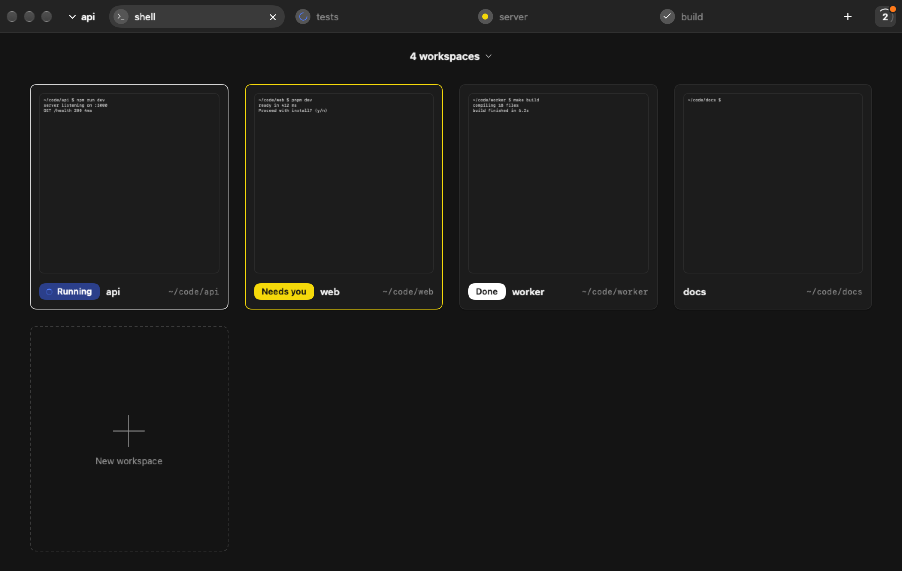
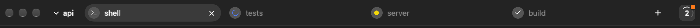
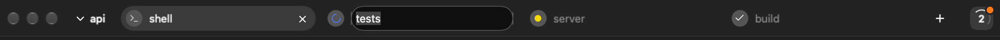
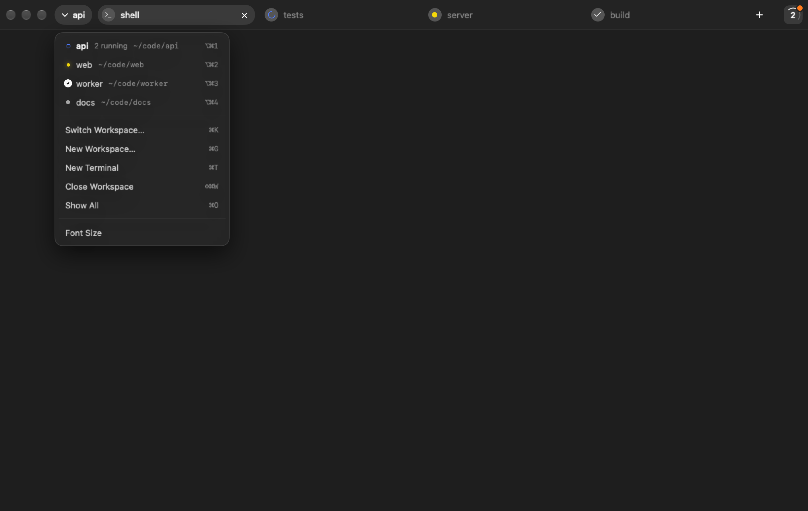
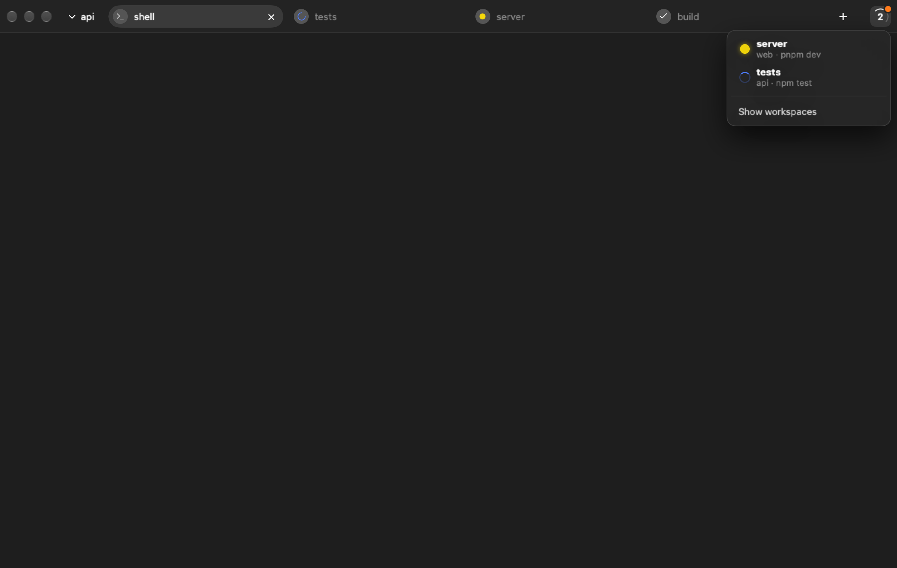
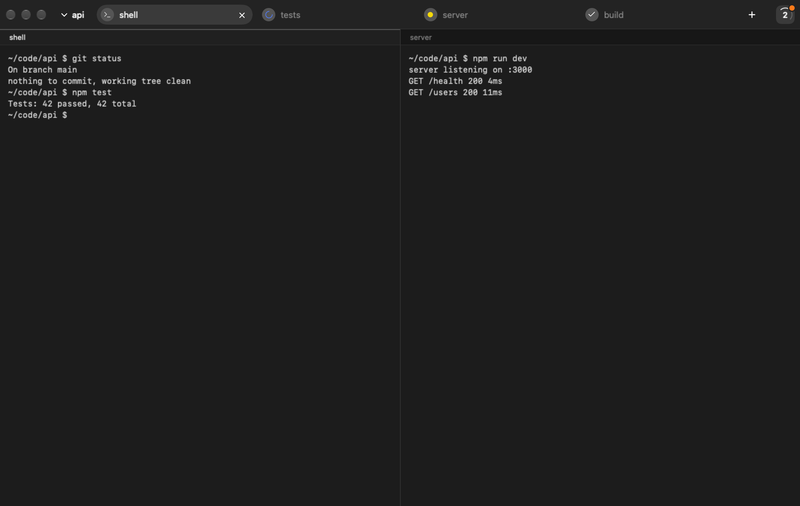

# Ghostty Workspaces

## What it is

Ghostty Workspaces is a fork of Ghostty for macOS that adds workspaces to the terminal window. Its purpose is to control several projects from one window.

A window holds a list of workspaces. A workspace is a project, backed by a folder. Tabs are terminals inside a workspace. Each terminal carries its own activity indicator, and a badge at the right of the title bar summarizes the activity of the whole window. Two overlays give the overview: a grid of all workspaces and a popover listing the terminals in progress.



macOS only. Based on Ghostty 1.4.1-dev at commit e95bed6.

Repository: https://github.com/fabriciomirandabr/ghostty

## Install

1. Download the `.dmg` or `.zip` from GitHub Releases.
2. Move the app to `/Applications`.
3. Launch it.

The build is self-signed and not notarized, so Gatekeeper blocks the first launch. Open it once with a right-click and then Open, or remove the quarantine attribute from the app bundle:

```
xattr -d com.apple.quarantine "/Applications/Ghostty Workspaces.app"
```

The app installs beside stock Ghostty. It has its own bundle id `com.fabriciomirandabr.ghostty-workspaces` and shares `~/.config/ghostty/config` with stock Ghostty.

## Enable

Add this line to `~/.config/ghostty/config`:

```
macos-titlebar-style = workspaces
```

The new title bar style applies to new windows. Existing windows keep the style they were opened with, and the other styles (`native`, `transparent`, `tabs`, `hidden`) keep upstream behavior.

To choose where the terminals of the `Default` workspace start, set:

```
workspace-default-directory = ~/code
```

The value is an absolute path or a path with a `~/` prefix. A path that does not exist or is not a directory is reported as a config error. The default is your home directory.

## Using it

### Default workspace

Every window has a workspace called `Default`, first in the list. It cannot be closed: its Close Workspace menu item is disabled and it has no x.

### Tabs

The tab bar shows one pill per tab of the active workspace: a circle state indicator on the left, the name, and an x on hover or when active. The `+` after the last pill opens a new terminal.





Rename a tab with `F2` (action `prompt_tab_title`) or a double click. An inline field appears, `Enter` applies the name (40 characters maximum), `Esc` cancels. Names persist.

### Workspace menu

The workspace button (chevron plus name) in the title bar opens a menu:

- The workspace list, each entry with state indicator, running count (`N running`), abbreviated folder and, for the first nine, its shortcut.
- Switch Workspace, New Workspace, New Terminal, Close Workspace, Show All.
- A Font Size submenu with 12, 13, 14, 15, 16 and 18.

Close Workspace is disabled on `Default`.



### New workspace

New Workspace opens a sheet with Name and Folder. `Choose...` opens a folder picker and pre-fills Name with the last path component, for example `api` for `~/code/api`. A duplicate name, compared case-insensitively, shows `A workspace with this name already exists.` and disables Create.

Every new terminal in a workspace starts in the workspace folder, not in the working directory of the focused terminal.

### Closing tabs and workspaces

Closing the last tab of a workspace opens a fresh shell tab. A workspace never has zero tabs.

Closing a workspace happens immediately when nothing is running. Otherwise an inline confirmation lists the running terminals (`N terminals running. Close anyway?`) with Cancel and Close. Closing selects the previous workspace in the list. Close a workspace from the menu, the card x or `Cmd+Shift+W`.

Inactive workspaces keep their processes alive and keep updating the badge.

### Activity badge

The badge at the right of the title bar counts the running terminals across the window. A white ring spins while the count is above zero. An orange dot appears when a terminal needs you.

Terminal states:

- running: blue
- needs you: yellow
- done: white, kept for 10 seconds, then idle
- idle

Aggregation priority: needs you, running, done, idle.

### Activity popover

Hover the badge for 250 ms, or press `Cmd+J`, to open the popover. It lists the terminals that are not idle, sorted by priority. Each row has the indicator, the tab name and `workspace · last command`. A click goes to that tab. An empty list shows `No terminals in progress.` The footer `Show workspaces` opens the grid.



### Workspace grid

Click the badge, or press `Cmd+O`, to open the grid of workspace cards. Each card has a thumbnail, a state badge (Running, Needs you, Done), the name and the folder. The header menu offers `Sort by name` and `Sort by activity`, with `Default` always first. A `+ New workspace` card sits in the grid. A click selects a workspace, `Esc` closes the grid. The thumbnail of the active workspace is live; inactive ones show the last snapshot taken when you left them.

### Quick switcher

`Cmd+K` opens a switcher that searches by name or folder. Arrow keys move, `Enter` selects, `Esc` closes. No result shows `No workspace found.`

### Splits

When a tab has splits, every pane gets a 24 pt header with the title and an x on hover. The active pane has a thin line on top. A tab without splits has no headers.



### Persistence

Workspaces, tabs, names, folders, splits and the selection are restored after a restart. `window-save-state = never` disables the restore.

Closing the window or quitting asks for confirmation, taking all workspaces into account.

## Keyboard shortcuts

The defaults below apply only with `macos-titlebar-style = workspaces`. An explicit `keybind` of yours always wins. Each default replaces one stock binding, and only that one: `Cmd+K` (`clear_screen`), `Cmd+J` (`scroll_to_selection`), `Cmd+G` (`navigate_search:next`), `Cmd+Shift+W` (`close_window`), `Cmd+Shift+[` (`previous_tab`), `Cmd+Shift+]` (`next_tab`). The defaults are not applied when `keybind = clear` is used. They are defined in `src/config/Config.zig`.

| Shortcut | Action |
| --- | --- |
| `Cmd+T` | `new_tab` |
| `Cmd+G` | `new_workspace` |
| `Cmd+K` | `toggle_workspace_switcher` |
| `Cmd+O` | `toggle_workspace_overview` |
| `Cmd+J` | `toggle_activity_popover` |
| `Cmd+Shift+W` | `close_workspace` |
| `Opt+Cmd+1` to `9` | `goto_workspace:N` |
| `Cmd+Shift+[` | `previous_workspace` |
| `Cmd+Shift+]` | `next_workspace` |
| `Cmd+1` to `9` | `goto_tab:N` (tab N of the active workspace) |
| `Cmd+D` | `new_split:right` |
| `Cmd+Shift+D` | `new_split:down` |
| `F2` | `prompt_tab_title` |

`Cmd+W` closes the pane or the tab.

Example rebind:

```
keybind = super+shift+n=new_workspace
```

All the workspace actions except `goto_workspace` are also available in the command palette (`goto_workspace`, like `goto_tab`, has no palette entry). On other title bar styles the workspace actions do nothing.

## Agent and CLI integration

### Activity state sources

A terminal becomes running on `OSC 133;C` (command start, which needs shell integration) until `133;D`, or on `OSC 9;4` with set or indeterminate progress. It needs you on a bell, an `OSC 9` or `OSC 777` desktop notification, or `OSC 9;4` error or pause. It is done when a command finishes (`OSC 133;D`) or a program reports status done. Without shell integration or a status report the terminal stays idle. There is no heuristic based on titles.

### OSC 7501 Program Status Protocol

A program uses this protocol to report what it is doing. Format:

```
ESC ] 7501 ; key=value:key=value ESC \
```

Keys:

- `state`: `idle`, `working`, `blocked`, `done`, `error` or `clear`
- `kind`: `permission`, `question` or `auth`, used with `blocked`
- `progress`: integer
- `title`, `msg`: base64 text. The parser accepts a title of up to 192 bytes and a message of up to 2048 bytes (decoded). The app keeps at most 127 bytes of the title and 255 bytes of the message, cut at a character boundary, so that is what the popover and the notifications can show
- `app`: short name, up to 32 bytes
- `id`: separates concurrent records, one record per id, each report replaces its record; `state=clear` removes the record of that id, or all records when no id is given

A whole sequence is at most 4096 bytes. Mapping to the indicator: `working` is running, `blocked` and `error` are needs you, `done` is done and `idle` is idle. `clear` removes the record and the terminal returns to the state derived from the shell (running when a command is in flight, otherwise idle). A new shell command (`OSC 133;C`) or the shell exiting also drops the records, so a status left behind by a program that quit does not hide later activity. At most 64 records are kept per terminal, the oldest is evicted first.

Send `ESC ] 7501 ; ? ESC \` to probe. A supporting terminal answers with `ESC ] 7501 ; ?:states=idle,working,done,blocked,error:kinds=...`.

Recent Claude Code versions emit the protocol.

Example with `printf`:

```sh
printf '\e]7501;state=working:app=build\e\\'
# ...
printf '\e]7501;state=done:app=build\e\\'
```

With a base64 message:

```sh
printf '\e]7501;state=blocked:kind=question:app=build:msg=%s\e\\' "$(printf 'Overwrite dist/?' | base64)"
```

### macOS notifications

A notification fires when a job finishes (running, then done) or needs you, if that terminal is not the focused one of the active workspace and tab. The title is `tab name · workspace name`, the body is `Done` or `Needs you`, plus up to 120 characters of detail from the program status message. A click focuses the workspace and the tab. Repeated notifications for the same terminal within 2 seconds are coalesced, and a needs-you notification is retracted when the state changes. macOS asks for permission on first launch.

Disable them with:

```
workspace-notifications = false
```

They are also off when the Ghostty option `desktop-notifications = false` is set. Terminal-requested `OSC 9` and `OSC 777` notifications are unaffected by `workspace-notifications`. The default is `true`.

### Pasting images

`Cmd+V` with an image on the clipboard sends `Ctrl+V` (0x16), so TUI agents read the image themselves. With any text on the clipboard, a copied path included, the paste is normal.

```
macos-paste-image-sends-ctrl-v = false
```

The default is `true`.

## Building from source

Requirements: Zig 0.17.0 (see `minimum_zig_version` in `build.zig.zon`) and Xcode 26.

```
zig build -Demit-macos-app=false -Doptimize=ReleaseFast
xcodebuild -project macos/Ghostty.xcodeproj -scheme Ghostty -configuration Release build
```

SwiftPM can hang while resolving Sparkle if the login keychain is locked. Unlock it first. If you redistribute, sign the app with your own identity and set your own bundle id.

## Differences from upstream

- `macos/Sources/Features/Workspaces/` holds the model, title bar, overlays, activity tracking and notifier.
- New `macos-titlebar-style` value `workspaces`.
- Handler and app plumbing for the existing OSC 7501 parser (`src/terminal/osc/parsers/program_status.zig`): `src/termio/stream_handler.zig`, the `program_status` action and the macOS activity tracking.
- New `command_started` action from `OSC 133;C` into the app.
- Eight new keybind actions (`new_workspace`, `close_workspace`, `goto_workspace`, `previous_workspace`, `next_workspace`, `toggle_workspace_overview`, `toggle_workspace_switcher`, `toggle_activity_popover`), all with command palette entries except `goto_workspace`.
- New config keys `workspace-default-directory`, `workspace-notifications`, `macos-paste-image-sends-ctrl-v`.
- Restorable state version 8.
- Renamed bundle id.

Other title bar styles keep upstream behavior. On Linux/GTK there is no UI and the new actions are no-ops.

## Known limitations

- macOS only.
- The font size picked from the workspace menu applies to the current terminals. It is not applied to surfaces created later and is not persisted; set `font-size` in the config instead.
- Fullscreen bar height differs from windowed height.
- The build is not notarized.
- Features tied to native tab groups are off under this style: dragging a tab between windows, Merge All Windows, `close_other_tabs`, `close_tabs_right`, `move_tab_to_new_window`, AppleScript tab groups.
- `Cmd+N` opens a second, independent workspaces window.
- UI text is English only.
- An agent that asks a question without OSC 7501 or a bell is not detected.
- Switching away from the workspaces style after saving state restores only the visible tab; hidden workspaces are dropped (their shells are started during decoding and then discarded).
